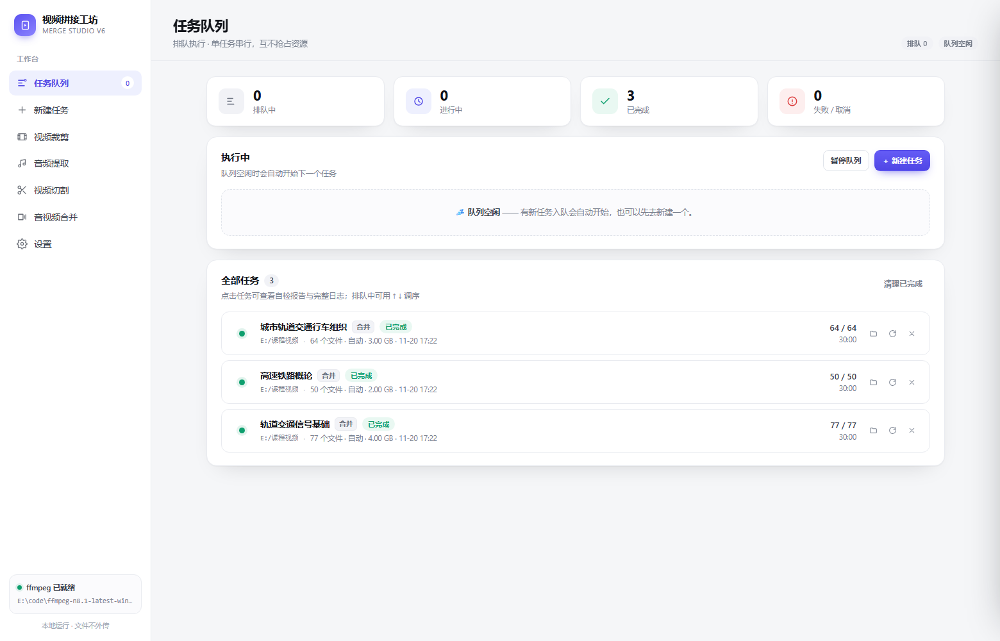
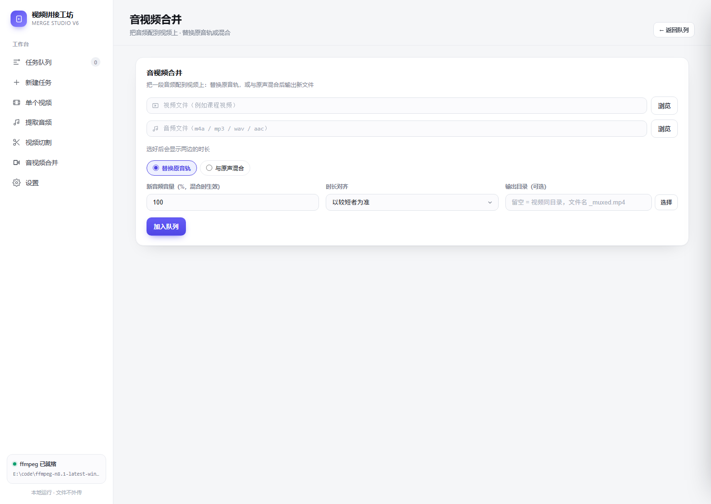
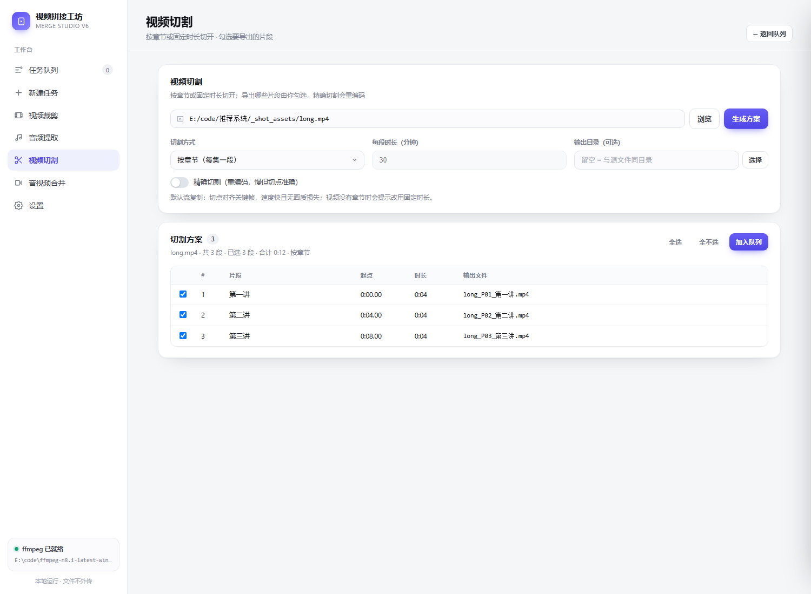

# 视频拼接工坊 · MergeStudio

把一整个文件夹的网课视频按顺序拼成一条长视频，顺带解决时长错乱、音视频不同步、
台标遮挡等问题。所有处理都在本机完成，文件不上传。

> v6 把原来的单文件脚本重构成可维护的 Python 包，并陆续加入画面裁剪、提取音频、
> 视频切割与「单个视频」处理；v6.4 补齐长任务闭环：队列持久化、完成通知 + 托盘、
> 字幕轨保留与同名输出保护。



## 功能

**合并**
- 按文件夹批量合并，支持拖拽调整顺序、包含子文件夹
- 合并前预检：红/黄/绿健康度，标出时间基/采样率异类、无音频、Edit List 等风险
- 三种模式：自动（参数一致则无损直拷，少数派单独转码）、全部直拷、全部转码
- 统一音频采样率与视频 time_base，避免拼完时长被拉伸
- 批量裁剪片头片尾、写入章节标记、合并后自检（时长/同步/帧数/章节）
- **失败处理可选**：某集转码失败时，由你决定「整批中止」还是「跳过该集继续」
- **断点续跑**：失败或取消后保留已完成分段，任务详情里可一键从断点继续
- 单个分段偶发失败时底层自动重试 2 次（磁盘满、坏文件不重试）

**视频裁剪（v6.5 起支持批量）**
- 只处理一个视频：裁掉水印 / 台标 / 黑边，或剪掉片头片尾，输出为新文件，不动源文件
- **批量模式**：选一个文件夹（可含子目录），扫描后一次排队，把每个视频各自裁一遍，
  **分别输出，不合并**——适合同一批课要统一去台标、但彼此不是同一门课不能拼的情形
- 批量模式下用第一个视频做裁剪预览；参数套用到全部视频，每个文件独立校验裁剪范围
- 真实抽帧预览 + 斜纹标出要裁掉的部分，四边像素可精确到 1px
- 「自动检测黑边」用逐行/逐列亮度统计（抗噪点、抗台标），cropdetect 兜底
- 并行裁剪、失败可「中止整批」或「跳过失败视频」；重复运行自动改名，不覆盖旧结果

**画面裁剪（合并任务里）**
- 整套素材统一裁掉顶部台标或四周黑边，和合并一次完成
- 预设「去顶部 60 / 80 px」「上下各 40 px」，也可手填四边像素
- 可选「裁完缩放回原分辨率」，默认保留裁剪后的尺寸（不拉伸）

**提取音频**
- 批量把视频音轨导出为 m4a（直接复制，最快、无损）或 mp3（libmp3lame）
- 也可以只处理单个视频（勾选「只处理单个视频」后选文件即可）
- 自动跳过没有音轨的文件，并在任务报告里列出

**音视频合并（v6.3 新增）**
- 把一段音频配到视频上：替换原音轨，或与原声混合（可调新音频音量）
- 时长对齐可选「以较短者为准」或「以视频时长为准（不足补静音）」
- 视频流直接复制，不重新编码画面，速度快、无画质损失

**视频切割（v6.1 新增）**
- 按内嵌章节切（每集一段），或按固定时长等分
- 生成方案后逐段勾选要导出的片段，起点/时长/输出名一目了然
- 默认流复制（切点对齐关键帧，快且无损）；需要精确切点时勾选「精确切割」重编码

**任务队列**
- 单 worker 串行执行，避免多任务抢磁盘
- 暂停/继续队列、调整优先级、取消、重试、移除、清理已完成
- 每个任务独立的进度、日志、自检报告
- **队列落盘**：排队中的任务和暂停状态都存进 `queue.json`，重启后接着跑；
  跑到一半被中断的任务会自动退回排队，并复用已转码好的分段
- 批量建任务：父目录下每个子文件夹各建一个任务

**长任务闭环（v6.4 新增）**
- 任务完成/失败弹系统通知（气泡），浏览器关掉也能看到
- 托盘常驻：右键可打开界面、暂停/继续队列、退出；悬浮显示当前任务
- 通知失败只影响提示，绝不影响任务本身（无桌面会话时自动静默降级）

**安全保护（v6.4 新增）**
- **字幕轨保留**：源视频带软字幕时，合并/裁剪/切割/音视频合并都会把字幕一起带过去
  （统一转 `mov_text`）；各文件字幕不一致或为位图字幕时自动放弃并说明原因
- **防丢文件**：输出路径不允许等于任何源文件，从根上避免「边读边写」毁掉素材
- **防丢内容**：目标同名文件默认自动改名为 `xxx_2.mp4`，旧结果不会被误覆盖；
  想覆盖可在设置页或任务参数里显式打开。扫描时还会排除自己上次产出的 `_merged` 系列，
  避免把成品当素材再拼一遍

## 截图

| 单个视频 · 去水印 / 裁剪 | 合并任务 · 预检 + 批量裁剪 |
| --- | --- |
|  |  |

| 提取音频 | 音视频合并 |
| --- | --- |
|  |  |

按章节切割，逐段勾选要导出的内容：



## 环境要求

- Python 3.9+
- ffmpeg / ffprobe（需自行安装，**要求 5.0+**；需要 libx264，字幕烧录另需 libass）
  - Windows 可用 [gyan.dev](https://www.gyan.dev/ffmpeg/builds/) 的 full build
  - 也可以在网页「设置」里填 ffmpeg.exe / bin 目录，留空则自动从 PATH 查找
- 硬件编码器可选：程序启动后会自动探测本机可用性，不可用的会直接禁用并说明原因
  - NVENC 需要 NVIDIA 显卡，QSV 需要 Intel 核显，AMF 需要 AMD 显卡
  - 不同编码器的 `-preset`/质量参数由程序自动换算，不会出现换了编码器就报错

## 快速开始

```bash
git clone <your-repo-url> MergeStudio
cd MergeStudio
python -m mergestudio            # 默认 http://127.0.0.1:8760/ 并自动打开浏览器
```

Windows 也可以直接双击 `启动.bat`（停止用 `停止.bat`）。

常用参数：

```bash
python -m mergestudio --port 9000     # 指定端口
python -m mergestudio --no-browser    # 不自动开浏览器
python -m mergestudio --stop          # 停止正在运行的实例
```

重复启动会自动复用已有实例并打开浏览器，不会起第二个服务。

## 目录结构

```
MergeStudio/
├── mergestudio/
│   ├── __main__.py      # 命令行入口、单实例、托盘/通知接线、优雅退出
│   ├── config.py        # 配置读写、ffmpeg 解析、同名输出策略
│   ├── encoders.py      # 编码器能力表、可用性探测、参数换算
│   ├── media/           # 媒体层（按职责拆开，__init__ 统一导出）
│   │   ├── probe.py     #   ffprobe 探测、自检、预检打分
│   │   ├── ffmpeg.py    #   跑 ffmpeg（进度 + 取消）、抽帧
│   │   ├── scan.py      #   目录扫描与分组统计
│   │   ├── paths.py     #   输出命名、覆盖保护、工作目录、定位文件
│   │   ├── crop.py      #   黑边检测
│   │   └── chapters.py  #   章节元数据
│   ├── subtitles.py     # 字幕轨探测与「是否保留」策略
│   ├── notify.py        # Windows 托盘 + 完成通知（ctypes，零依赖）
│   ├── store.py         # 原子 JSON 落盘
│   ├── task.py          # 任务对象、JOB 代理、序列化
│   ├── queue.py         # 串行队列 + 状态落盘
│   ├── runtime.py       # 进程探活、端口探测、运行记录
│   ├── jobs/
│   │   ├── merge.py     # 合并 / 裁剪 / 章节 / 并行转码 / 自检 / 续跑
│   │   ├── audio.py     # 提取音频
│   │   ├── split.py     # 按章节或时长切割
│   │   ├── video.py     # 单个视频：裁剪 / 剪头尾
│   │   └── mux.py       # 音视频合并（替换 / 混合）
│   └── web/
│       ├── __init__.py  # HTTP 服务与 JSON API
│       ├── index.html
│       └── static/      # app.js / style.css
├── tests/test_smoke.py  # 需要本机 ffmpeg 的端到端冒烟测试
├── docs/screenshots/
├── run.py               # python run.py 等价于 python -m mergestudio
├── 启动.bat / 停止.bat
└── start.sh
```

## 数据与配置

运行时数据都在项目根目录的 `.mergestudio/`（已加入 `.gitignore`）：

- `config.json`：ffmpeg / ffprobe 路径、同名输出策略、通知与托盘开关
- `queue.json`：完整队列快照（排队中 + 已结束），重启后据此恢复
- `history.json`：旧版遗留的已完成记录，首次启动会自动迁移进 `queue.json`
- `runtime.json`：当前实例的 PID 与端口，用于单实例判断

断点续跑的中间分段放在**输出目录**下的 `.merge_work_<任务ID>/`，成功后自动删除；
失败时保留，方便你选择「断点续跑」或直接移除任务（会一并清理）。

## HTTP API（本地）

| 方法 | 路径 | 说明 |
| --- | --- | --- |
| GET | `/api/ping` | 实例标识 |
| GET | `/api/config` | ffmpeg 状态 + 同名输出/通知设置 |
| POST | `/api/config` | 验证并保存路径 |
| POST | `/api/settings` | 保存同名输出策略与通知/托盘开关 |
| GET | `/api/notify` | 通知与托盘状态 |
| POST | `/api/notify/test` | 发一条测试通知 |
| POST | `/api/scan` | 扫描文件夹并预检 |
| GET | `/api/probe?path=` | 读取单个视频的分辨率/时长/音轨 |
| POST | `/api/detect-crop` | 自动检测黑边（亮度分析 + cropdetect） |
| POST | `/api/encoders/test` | 重新探测本机编码器 |
| POST | `/api/split/plan` | 按章节/时长生成切割方案 |
| POST | `/api/pick-video` | 选择单个视频文件 |
| POST | `/api/pick-audio` | 选择单个音频文件 |
| GET | `/api/thumb?path=&t=` | 抽取一帧 JPEG 用于裁剪预览 |
| GET | `/api/queue` | 队列快照 |
| GET | `/api/task?id=` | 单任务详情（含日志） |
| POST | `/api/queue/{add,batch,cancel,retry,remove,move,clear,pause}` | 队列操作 |
| POST | `/api/shutdown` | 优雅退出（先取消任务） |

## 测试

```bash
python -m unittest tests.test_smoke -v
```

测试会用 ffmpeg 现场生成几段 2 秒的测试片，跑通「裁剪合并 → 抽帧 → 提取音频 → 字幕保留」，
不依赖任何真实素材；没有配置 ffmpeg 时会自动跳过。覆盖保护、字幕策略、队列落盘这类
纯逻辑用例不需要 ffmpeg，始终会跑。当前共 25 个用例。

## 常见问题

**双击 bat 闪一下就没了？**
脚本里的中文提示必须用 GBK 保存（本仓库的 bat 已经是 GBK + `chcp 936`）。
如果用编辑器改成 UTF-8，cmd 会把多字节字符截断，导致整段脚本解析失败。

**只要批量裁剪、不要合并，怎么弄？**
进「视频裁剪」页，把模式切到「批量文件夹」，选好文件夹点「扫描」，
再设裁剪四边或片头片尾，点「批量加入队列」即可。每个视频会各自输出
`<原名>_cropped.mp4`（只剪头尾则是 `_edited.mp4`），互不拼接。
重复跑同一批素材时，上次生成的 `_cropped` 文件不会再次被当素材，
新结果自动改名成 `_cropped_2.mp4`，旧文件保留。

**裁剪后为什么变慢了？**
裁剪无法流复制，必须重编码，因此启用裁剪会强制该任务「全部转码」。
如果只是去掉片头片尾，用「片头/片尾裁剪」即可保持无损。

**输出目录要手动粘贴路径吗？**
不用。合并、单视频、切割、音频、音视频合并的输出目录旁边都有「选择」按钮，
点一下就能选文件夹；任务完成后点「打开所在文件夹」会直接定位到输出文件。

**切换硬件编码器会不会报错？**
不会。程序在任务开始前会跑一段 1 秒测试编码来确认编码器可用，
不可用的选项在界面上直接禁用并写明原因；`-preset`/质量参数会按编码器自动换算。
注意 NVENC 在消费级显卡上有并发上限，队列会自动把并行数收敛到 3。

**失败后输出目录多了 `.merge_work_xxx` 文件夹？**
那是断点续跑保留的已完成分段，不是垃圾文件。点任务详情里的「断点续跑」会复用它、
成功后再删除；不想续跑就在队列里移除该任务，中间文件会一起清理。

**四个编码器全都不可用，还说 `Failed to set value '-f' for option 'nostdin'`？**
跟显卡无关，是 ffmpeg 太旧。`-nostdin` 是 ffmpeg 3.3 才有的参数，更老的版本会把它
当成未知的私有参数、顺手吃掉后面的 `-f`，于是每次探测都失败——注意连 CPU 编码
（libx264）也一起挂，这本身就说明问题不在显卡。换 gyan.dev 的 full build（5.0+）即可。
v6.4.1 起已经不再用这个参数，报错也会直接说明「ffmpeg 版本过旧」。

**只有 Intel 核显，QSV 还是不可用？**
核显也需要装 Intel 显卡驱动（不是主板芯片组驱动），装完重启再点「重新检测」。
太老的 CPU（四代以前）不支持 QuickSync，直接用 CPU 编码即可。

**「验证并保存」说这是 ffprobe，不是 ffmpeg？**
两个路径框填成同一个文件了。ffmpeg 负责转码、ffprobe 负责读信息，必须分别指定；
如果 ffprobe 留空，程序会自动从 ffmpeg 同目录推导。

**字幕能提取吗？**
分两种：视频里已经烧进画面的字幕没法提取（B 站课程大多如此）；如果是**软字幕轨**
（mkv/mp4 里独立的字幕流），v6.4 起合并、裁剪、切割、音视频合并都会**原样保留**，
mp4 里统一转成 `mov_text`。各文件字幕编码不一致、条数不同或是位图字幕（PGS）时会
自动放弃并在日志里说明——宁可少一条字幕，也不拼出坏文件。

**第二次跑同一个文件夹，结果怎么变成 `xxx_merged_2.mp4`？**
这是覆盖保护：同名文件默认不覆盖，自动加序号。想直接覆盖就去「设置 → 运行与提醒」
把「输出文件已存在时」改成覆盖，或在新建任务的高级参数里单独指定。

**关掉浏览器 / 关掉黑窗口，任务会丢吗？**
关浏览器不影响任务（服务和队列在后端跑）。关掉服务窗口则会先取消当前任务再退出；
排队中没跑到的任务已经写进 `queue.json`，下次启动会继续排队，上次跑到一半的任务
会重新排队并复用已转码的分段。

## Roadmap

- [x] 按章节 / 时长切割
- [x] 断点续跑（保留已完成分段）
- [x] 分段容错：跳过失败集并生成报告
- [x] 软字幕轨保留（v6.4）
- [x] 任务完成系统通知 / 托盘（v6.4）
- [x] 队列持久化：重启不丢排队任务（v6.4）
- [ ] 字幕烧录（硬字幕）与字幕文件导入
- [ ] 压缩到目标大小

## License

[MIT](LICENSE)
