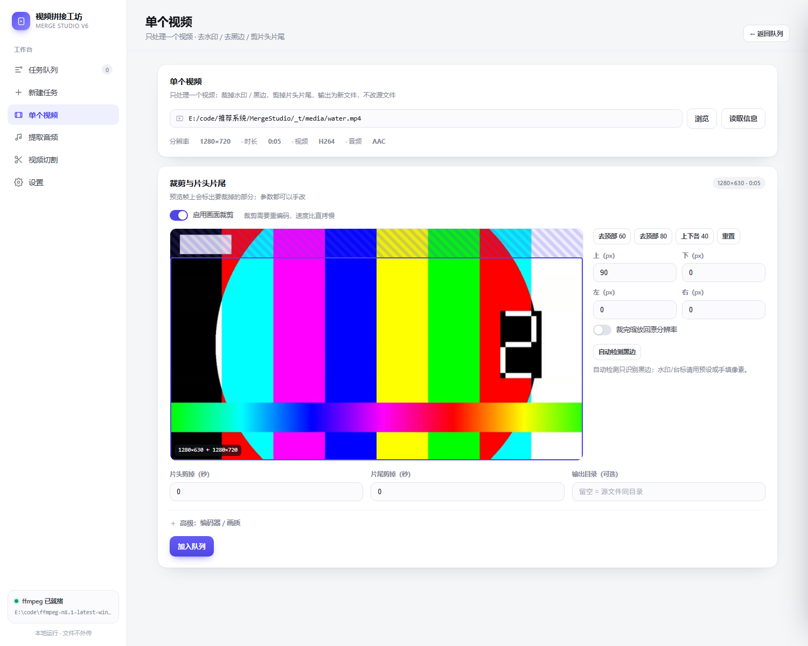

# 视频拼接工坊 · MergeStudio

把一整个文件夹的网课视频按顺序拼成一条长视频，顺带解决时长错乱、音视频不同步、
台标遮挡等问题。所有处理都在本机完成，文件不上传。

> v6 把原来的单文件脚本重构成可维护的 Python 包，并陆续加入画面裁剪、提取音频、
> 视频切割与「单个视频」处理。


## 功能

**合并**
- 按文件夹批量合并，支持拖拽调整顺序、包含子文件夹
- 合并前预检：红/黄/绿健康度，标出时间基/采样率异类、无音频、Edit List 等风险
- 三种模式：自动（参数一致则无损直拷，少数派单独转码）、全部直拷、全部转码
- 统一音频采样率与视频 time_base，避免拼完时长被拉伸
- 批量裁剪片头片尾、写入章节标记、合并后自检（时长/同步/帧数/章节）
- **失败处理可选**：某集转码失败时，由你决定「整批中止」还是「跳过该集继续」
- **断点续跑**：失败或取消后保留已完成分段，任务详情里可一键从断点继续
- 单个分段偶发失败时底层自动重试 2 次（磁盘满、坏文件不重试）

**单个视频（v6.2 新增）**
- 只处理一个视频：裁掉水印 / 台标 / 黑边，或剪掉片头片尾，输出为新文件，不动源文件
- 真实抽帧预览 + 斜纹标出要裁掉的部分，四边像素可精确到 1px
- 「自动检测黑边」用逐行/逐列亮度统计（抗噪点、抗台标），cropdetect 兜底

**画面裁剪（合并任务里）**
- 整套素材统一裁掉顶部台标或四周黑边，和合并一次完成
- 预设「去顶部 60 / 80 px」「上下各 40 px」，也可手填四边像素
- 可选「裁完缩放回原分辨率」，默认保留裁剪后的尺寸（不拉伸）

**提取音频**
- 批量把视频音轨导出为 m4a（直接复制，最快、无损）或 mp3（libmp3lame）
- 自动跳过没有音轨的文件，并在任务报告里列出

**视频切割（v6.1 新增）**
- 按内嵌章节切（每集一段），或按固定时长等分
- 生成方案后逐段勾选要导出的片段，起点/时长/输出名一目了然
- 默认流复制（切点对齐关键帧，快且无损）；需要精确切点时勾选「精确切割」重编码

**任务队列**
- 单 worker 串行执行，避免多任务抢磁盘
- 暂停/继续队列、调整优先级、取消、重试、移除、清理已完成
- 每个任务独立的进度、日志、自检报告；历史落盘，重启后仍可查
- 批量建任务：父目录下每个子文件夹各建一个任务

## 截图

| 单个视频 · 去水印 / 裁剪 | 合并任务 · 预检 + 批量裁剪 |
| --- | --- |
|  |  |

| 提取音频 | 按章节切割 |
| --- | --- |
|  |  |

## 环境要求

- Python 3.9+
- ffmpeg / ffprobe（需自行安装，建议 5.0+；需要 libx264，字幕烧录另需 libass）
  - Windows 可用 [gyan.dev](https://www.gyan.dev/ffmpeg/builds/) 的 full build
  - 也可以在网页「设置」里填 ffmpeg.exe / bin 目录，留空则自动从 PATH 查找
- 硬件编码器可选：程序启动后会自动探测本机可用性，不可用的会直接禁用并说明原因
  - NVENC 需要 NVIDIA 显卡，QSV 需要 Intel 核显，AMF 需要 AMD 显卡
  - 不同编码器的 `-preset`/质量参数由程序自动换算，不会出现换了编码器就报错

## 快速开始

```bash
git clone <your-repo-url> MergeStudio
cd MergeStudio
python -m mergestudio            # 默认 http://127.0.0.1:8760/ 并自动打开浏览器
```

Windows 也可以直接双击 `启动.bat`（停止用 `停止.bat`）。

常用参数：

```bash
python -m mergestudio --port 9000     # 指定端口
python -m mergestudio --no-browser    # 不自动开浏览器
python -m mergestudio --stop          # 停止正在运行的实例
```

重复启动会自动复用已有实例并打开浏览器，不会起第二个服务。

## 目录结构

```
MergeStudio/
├── mergestudio/
│   ├── __main__.py      # 命令行入口、单实例、优雅退出
│   ├── config.py        # 路径、ffmpeg 解析与配置读写
│   ├── encoders.py      # 编码器能力表、可用性探测、参数换算
│   ├── media.py         # ffprobe 探测、扫描分组、ffmpeg 执行、抽帧、cropdetect
│   ├── task.py          # 任务对象与 JOB 代理
│   ├── queue.py         # 串行队列、历史落盘
│   ├── runtime.py       # 进程探活、端口探测、运行记录
│   ├── jobs/
│   │   ├── merge.py     # 合并 / 裁剪 / 章节 / 自检 / 续跑
│   │   ├── audio.py     # 提取音频
│   │   ├── split.py     # 按章节或时长切割
│   │   └── video.py     # 单个视频：裁剪 / 剪头尾
│   └── web/
│       ├── __init__.py  # HTTP 服务与 JSON API
│       ├── index.html
│       └── static/      # app.js / style.css
├── tests/test_smoke.py  # 需要本机 ffmpeg 的端到端冒烟测试
├── docs/screenshots/
├── run.py               # python run.py 等价于 python -m mergestudio
├── 启动.bat / 停止.bat
└── start.sh
```

## 数据与配置

运行时数据都在项目根目录的 `.mergestudio/`（已加入 `.gitignore`）：

- `config.json`：ffmpeg / ffprobe 路径
- `history.json`：已结束任务的历史（只保留最近 40 条）
- `runtime.json`：当前实例的 PID 与端口，用于单实例判断

断点续跑的中间分段放在**输出目录**下的 `.merge_work_<任务ID>/`，成功后自动删除；
失败时保留，方便你选择「断点续跑」或直接移除任务（会一并清理）。

## HTTP API（本地）

| 方法 | 路径 | 说明 |
| --- | --- | --- |
| GET | `/api/ping` | 实例标识 |
| GET | `/api/config` | ffmpeg 状态 |
| POST | `/api/config` | 验证并保存路径 |
| POST | `/api/scan` | 扫描文件夹并预检 |
| GET | `/api/probe?path=` | 读取单个视频的分辨率/时长/音轨 |
| POST | `/api/detect-crop` | 自动检测黑边（亮度分析 + cropdetect） |
| POST | `/api/encoders/test` | 重新探测本机编码器 |
| POST | `/api/split/plan` | 按章节/时长生成切割方案 |
| POST | `/api/pick-video` | 选择单个视频文件 |
| GET | `/api/thumb?path=&t=` | 抽取一帧 JPEG 用于裁剪预览 |
| GET | `/api/queue` | 队列快照 |
| GET | `/api/task?id=` | 单任务详情（含日志） |
| POST | `/api/queue/{add,batch,cancel,retry,remove,move,clear,pause}` | 队列操作 |
| POST | `/api/shutdown` | 优雅退出（先取消任务） |

## 测试

```bash
python -m unittest tests.test_smoke -v
```

测试会用 ffmpeg 现场生成几段 2 秒的测试片，跑通「裁剪合并 → 抽帧 → 提取音频」，
不依赖任何真实素材；没有配置 ffmpeg 时会自动跳过。

## 常见问题

**双击 bat 闪一下就没了？**
脚本里的中文提示必须用 GBK 保存（本仓库的 bat 已经是 GBK + `chcp 936`）。
如果用编辑器改成 UTF-8，cmd 会把多字节字符截断，导致整段脚本解析失败。

**裁剪后为什么变慢了？**
裁剪无法流复制，必须重编码，因此启用裁剪会强制该任务「全部转码」。
如果只是去掉片头片尾，用「片头/片尾裁剪」即可保持无损。

**切换硬件编码器会不会报错？**
不会。程序在任务开始前会跑一段 1 秒测试编码来确认编码器可用，
不可用的选项在界面上直接禁用并写明原因；`-preset`/质量参数会按编码器自动换算。
注意 NVENC 在消费级显卡上有并发上限，队列会自动把并行数收敛到 3。

**失败后输出目录多了 `.merge_work_xxx` 文件夹？**
那是断点续跑保留的已完成分段，不是垃圾文件。点任务详情里的「断点续跑」会复用它、
成功后再删除；不想续跑就在队列里移除该任务，中间文件会一起清理。

**字幕能提取吗？**
B 站课程的视频通常没有字幕轨（字幕已经烧进画面），无法提取。
本工具预留了字幕能力的方向，但当前版本只做音频提取。

## Roadmap

- [x] 按章节 / 时长切割
- [x] 断点续跑（保留已完成分段）
- [x] 分段容错：跳过失败集并生成报告
- [ ] 字幕烧录与软字幕封装
- [ ] 压缩到目标大小
- [ ] 任务完成系统通知 / 托盘

## License

[MIT](LICENSE)
